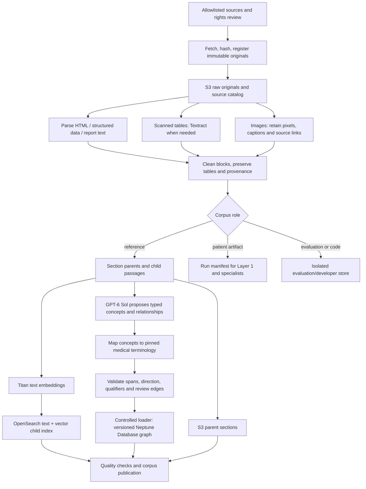
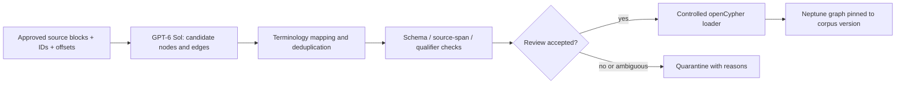

# Layer 00 — Ingestion and knowledge preparation

**Status:** Architecture adopted, 2026-10-23. Source selection researched; acquisition and executable ingestion adapters remain to be implemented in the harness.  
**Source manifest:** [00-ingestion-sources.json](00-ingestion-sources.json).  
**Consumers:** Layer 1 receives registered patient artifacts; Layer 3 receives versioned reference passages, embeddings, graph relationships, and provenance.

## What this pipeline prepares

Translate the supplied whiteboard into our selected AWS stack: document parsing/OCR, clean parent/child text, Titan embeddings into OpenSearch, source-backed graph extraction, and S3 originals. OpenSearch holds both keyword-searchable text and vectors; two separate keyword/vector databases are unnecessary. The selected managed graph target is Neptune Database with openCypher; versioned local graph exports support inspection and an explicitly labeled fallback. SQLite tracks ingestion jobs and workflow state. This revises the earlier local-first graph choice; provisioning remains unimplemented.

Keep three lanes separate:

| Lane | Contents | Destination and use |
| --- | --- | --- |
| Reference knowledge | Approved medical explanations and guidance | Shared RAG index and source-backed knowledge graph |
| Patient/demo artifacts | One scenario's text, lab report, radiology report/image, ECG report/image | Run-scoped S3 artifacts and manifest; specialist analysis |
| Evaluation and developer material | Expected answers, dataset labels, code samples | Separate evaluation/developer storage; excluded from medical retrieval |

Patient observations do not become general reference knowledge. Published cases are examples, not universal clinical guidance. Expected answers and held-out diagnostic labels must not leak into the model's evidence context.

## Pipeline



Cohere reranking and RRF run during query retrieval, not while ingesting documents. Prepare the OpenSearch RRF pipeline during setup. Do not rerank the corpus without a query.

## Exact starter reference corpus: nine pages

Use one small allowlisted corpus first. Download the main article text and headings from these URLs; do not recursively crawl their links. Retain source title, URL, visible update date if present, acquisition time, and rights notice. The linked manifest has stable source IDs.

| ID | Source | Ingest purpose |
| --- | --- | --- |
| ref-bnp | [MedlinePlus: BNP/NT-proBNP tests](https://medlineplus.gov/lab-tests/natriuretic-peptide-tests-bnp-nt-probnp/) | Test explanation and interpretation limitations |
| ref-bmp | [MedlinePlus: basic metabolic panel](https://medlineplus.gov/lab-tests/basic-metabolic-panel-bmp/) | Lab components and explanatory context |
| ref-potassium | [MedlinePlus: potassium blood test](https://medlineplus.gov/lab-tests/potassium-blood-test/) | Electrolyte explanation and uncertainty |
| ref-ecg | [MedlinePlus: electrocardiogram](https://medlineplus.gov/lab-tests/electrocardiogram/) | What an ECG measures and what results can mean |
| ref-hf-diagnosis | [NHLBI: heart failure diagnosis](https://www.nhlbi.nih.gov/health/heart-failure/diagnosis) | Context for combining tests; not an image-analysis training set |
| ref-hf-symptoms | [NHLBI: heart failure symptoms](https://www.nhlbi.nih.gov/health/heart-failure/symptoms) | Symptom and condition context |
| ref-hf-living | [NHLBI: living with heart failure](https://www.nhlbi.nih.gov/health/heart-failure/living-with) | Follow-up and patient discussion context |
| ref-foods | [NHLBI: heart-healthy foods](https://www.nhlbi.nih.gov/health/heart-healthy-living/healthy-foods) | General nutrition references |
| ref-activity | [NHLBI: physical activity](https://www.nhlbi.nih.gov/health/heart-healthy-living/physical-activity) | General activity references with their qualifiers |

This is a limited educational corpus, not a complete clinical guideline library. It cannot support broad autonomous diagnosis or prescriptions. Keep source qualifications; a general healthy-living page does not establish patient-specific exercise clearance.

Propagate the manifest's multi-valued retrieval_scopes to every derived parent and child. Layer 4 defines nutrition/physio primary and contextual sources. Shared sources must remain retrievable across their allowed scopes even when their descriptive specialty is synthesis.

MedlinePlus distinguishes public-domain content from licensed third-party content; NHLBI likewise notes exceptions to its general public-domain policy. Capture page-level terms and exclude separately licensed images or linked content without permission. Public accessibility alone is not the ingestion license. [MedlinePlus reuse policy](https://medlineplus.gov/about/using/usingcontent/), [NHLBI policy](https://www.nhlbi.nih.gov/about/contact/trademark-branding-and-logo)

## Patient scenario and exact artifacts to prepare

Proposed first scenario: a clearly fictional adult asks what supplied lab, chest-report, and ECG information means together, including questions about food and activity. Use a possible heart-related explanation as the retrieval theme, while retaining alternatives and missing information. This is a demo design, not a diagnosis selected in advance by the runtime.

Create one coherent synthetic fixture, demo-001, with these files during harness preparation:

| Artifact | Required contents |
| --- | --- |
| patient-context.json | synthetic=true, scenario ID, fictional context, symptom timeline, known/unknown history, original user question |
| labs.json | Test names, synthetic values, units, sample time, explicitly supplied demo reference intervals, and provenance for every field |
| lab-report.png | A readable rendered table matching labs.json, visibly labeled synthetic; image intake fixture |
| radiology-report.txt | An authored synthetic report with findings, limitations, and explicit synthetic origin |
| ecg-report.txt | Authored synthetic measurements/interpretation with source type report; not claimed to result from waveform analysis |
| artifact-manifest.json | IDs, modality, media type, hashes, source paths, scenario ID and synthetic status |
| expected-behavior.json | Separate evaluation-only assertions: extraction fields, routing, evidence needs, missing facts, expected pauses |

Do not claim this baseline demonstrates independent X-ray or waveform interpretation: it demonstrates report explanation and multimodal lab-image intake. Add a real image adapter test as described below if image interpretation is part of the final pitch. The fixture's numeric values and clinical consistency still need to be authored and reviewed; this document does not pretend those artifacts already exist.

Never merge unrelated real patients' labs, X-rays, and ECGs into a purported single-patient record. If demonstrating unrelated public examples, use separate scenario IDs. If a presentation combines illustrative examples, label it as a composite and do not infer cross-test clinical relationships.

## Public datasets and GitHub sources to use selectively

### Synthea: optional synthetic patient generator

[Synthea repository](https://github.com/synthetichealth/synthea) and [sample-data repository](https://github.com/synthetichealth/synthea-sample-data) provide a route to synthetic records. For a generated fixture, pin the generator version/configuration/seed and retain exactly one selected patient's FHIR bundle. Extract Patient, Encounter, Observation, Condition, DiagnosticReport, and medication resources only when actually present. Do not assume Synthea supplies radiology pixels or ECG waveforms, or that one random record contains the required tests.

For tomorrow, the authored synthetic fixture avoids making generator installation and case selection a prerequisite. Record all edits as synthetic adaptations; do not claim adapted values were generated unchanged by Synthea. Retain the generator/sample license and attribution separately from third-party asset licenses.

### MultiCaRe: preferred optional real-image case candidate

[Maintainer repository](https://github.com/mauro-nievoff/MultiCaRe_Dataset) and [dataset release](https://zenodo.org/records/15814064) provide linked clinical cases, images, and captions. Acquire metadata first; filter for one chest-radiology case relevant to the selected topic. Then fetch only its case text, one selected image, caption, source article identifier, and applicable license.

Pin the actual release, article/case ID, image ID, checksum, and source license before use. A repository's code license does not replace article/figure licensing. No specific matching case/image has been selected or downloaded yet. If none passes review, retain the synthetic report baseline rather than claiming an unavailable matched dataset.

Keep captions/known diagnoses in the evaluation lane for blind image tests. They may be supplied in a report-explanation mode only if the UI explicitly identifies that mode. MultiCaRe case facts do not become guideline-level graph relationships.

### PTB-XL 1.0.3: optional ECG adapter evaluation

[PTB-XL dataset](https://physionet.org/content/ptb-xl/1.0.3/) is a candidate for waveform work after the image/report baseline. Fetch ptbxl_database.csv, scp_statements.csv, and the release license first. Select two records for a small adapter test: one normal-labeled and one relevant abnormal-labeled record after inspecting the metadata. Fetch only each selected record's header/data pair using the provided record-path fields, preserving its rate and lead metadata.

Use separate scenario IDs and keep labels/reports out of blind prediction context. A rendered waveform image is a derived artifact with a parent record ID and rendering parameters, not native support for raw waveform analysis. Record exact selected ECG IDs after selection; do not invent them in the manifest.

### Sources to defer

- [MIMIC-CXR-JPG](https://physionet.org/content/mimic-cxr-jpg/2.1.0/) has credentialed access requirements. Do not make access approval a prerequisite for tomorrow.
- NIH ChestX-ray14, PathVQA, and large QA/case collections in the project README are later evaluation/training candidates. Do not bulk-ingest them into patient-facing medical retrieval by default.
- Unknown-license web images and scraped private records are excluded.

### Code references, excluded from medical retrieval

- [AWS Healthcare Agents](https://github.com/aws-samples/sample-healthcare-agents): inspect FHIR integration and workflow patterns. Do not deploy its full infrastructure as an ingestion dependency.
- [AWS Agentic RadMapper](https://github.com/aws-samples/sample-agentic-radmapper): inspect radiology workflow patterns; it is not a verified radiology diagnosis model or medical reference corpus.

Pin repository commits if code is reused and retain license notices. Source inspection here does not mean the repositories were cloned or their code executed.

## Processing stages and outputs

1. **Register and fetch.** Read only approved manifest entries. Record rights, corpus role and format. Fetch with timeouts/size limits; save immutable raw bytes, source URI, acquired_at, and SHA-256. A failed acquisition becomes failed/quarantined, not a successful empty document.
2. **Parse.** HTML: extract article headings/body and exclude navigation/scripts. JSON/FHIR: parse fields directly. Machine-readable reports: preserve text and layout identifiers. Scanned report tables: use Textract when needed. Offline reference PDFs may use a text parser or OCR adapter without expanding Layer 1's accepted upload types.
3. **Preserve multimodal evidence.** Keep actual image bytes with their source/caption links. Textract extracts text/tables; it does not interpret chest images or ECG traces. Optional vision descriptions are marked model-generated and cannot replace the original image or become unreviewed clinical facts.
4. **Clean and validate.** Normalize whitespace, retain negation, headings, units, ranges, tables, and dates. Preserve a mapping from cleaned spans to original blocks/pages. Do not fix uncertain numerical OCR through a guess. Quarantine unresolved numerical/table ambiguity.
5. **Create parents and children.** Use section boundaries for parents, initially targeting 800–1,500 tokens, and 200–400 token children with about 40-token overlap. Keep table headers attached to rows and avoid splitting a value from its units/range. These are tunable defaults; short pages may be a single parent.
6. **Index text and vectors.** Embed children with Titan V2 using one configured dimension. Store text, vector, parent_id, source offsets, specialty, corpus_role, license reference, and corpus_version in one OpenSearch child index. Store full parents in S3. Do not index evaluation labels or run-scoped patient text in this reference index.
7. **Propose graph facts.** GPT-6 Sol is the preferred configurable extractor; Sonnet 4.6 is a separately configured fallback. The extractor receives only approved source blocks and proposes typed entities/relationships with exact supporting spans. Map concepts to pinned terminology where available. Require known relation types, source IDs, qualifiers, and negation. Validate IDs and quoted-span existence in code; manually review the small first graph for whether passages actually support each edge. See the extraction contract below.
8. **Publish a coherent version.** Stage index, parents, graph and source manifest under one corpus version. Publish an active manifest only after checks pass. Pin each run to that version. Reprocessing identical bytes/parser/model settings should reuse derived artifacts rather than double-indexing them.

Use deterministic derived IDs based on source hash, block offsets, and processing version. Changing extraction or embedding settings produces a new version. Publication rollback changes the active version; do not delete source evidence needed by existing runs.

## Graph output and optional ontology

The baseline graph uses Layer 3's Finding, Condition, Test, Anatomy, Guidance, and SourcePassage concepts. Each edge carries edge_id, endpoints, relationship_type, supporting source and span IDs, qualifiers, extraction_method, and review_status.

A useful seed target is 15–30 concepts and 20–40 reviewed edges, but source support takes precedence over counts. Do not pad the graph to manufacture five-hop demonstrations. Test traversal depth using separate structural fixtures if the medical corpus has no meaningful five-hop path.

Do not promote patient-specific findings into this shared graph. An optional run-scoped patient evidence graph must retain its scenario boundary. Ontology checks remain optional, while schema and provenance checks are required.

### LLM concept and relationship extraction into Neptune

**Preferred model:** GPT-6 Sol. Use a bounded structured extraction call per approved source block/batch, with a configurable input/output budget. Start evaluation with medium reasoning effort; adjust only after measuring extraction quality, cost and latency. This is a proposed configuration, not a demonstrated medical extraction benchmark.

Official OpenAI documentation confirms the model ID `gpt-6-sol` and structured-output support. For the AWS route, its Bedrock guide documents GPT-6 Sol in `us-east-1`: Mantle model ID `openai.gpt-6-sol`, or Bedrock Runtime US inference profile `us.openai.gpt-6-sol`. The endpoint family determines the correct identifier; do not interchange them. Verify account access, supported request/schema options, SDK version and approved routing before implementation. Do not assume the earlier candidate `us-west-2` applies to this extractor. [GPT-6 Sol model documentation](https://developers.openai.com/api/docs/models/gpt-6-sol), [OpenAI on Bedrock](https://developers.openai.com/api/docs/guides/amazon-bedrock). Checked 2026-10-23.

Use the AWS route when available within approved boundaries. A direct OpenAI API route is a distinct configurable deployment choice and must not silently replace an unavailable Bedrock endpoint. If GPT-6 Sol is unavailable, select the configured Sonnet fallback explicitly and record the actual provider/model; no automatic unbounded model switching or JSON-repair loop.

Nodes represent concepts such as Finding, Condition, Test, Anatomy and Guidance. Cause and effect are roles of endpoint concepts connected by a causal relationship; they are not generic node classes. An LLM extracts source assertions; it does not establish causality from co-occurrence or from patient test results.



Reuse [existing terminology resources](ontology-research.md) for identifiers, synonyms and established hierarchy edges. Map only where supported; retain ambiguous/unmapped candidates for review. Cross-references are not automatically equivalence. Preserve original labels and terminology versions. A legitimate ontology concept does not by itself support a clinical edge extracted from text.

Extraction output contract (application assigns durable IDs after validation):

```text
GraphExtractionBatch
  batch_id, corpus_version, source_id, source_version, block_ids[]
  extractor: provider, endpoint_family, model_id, prompt_version, schema_version
  proposed_nodes[]
    candidate_id, label, concept_type, source_mentions[]
    mapping_candidates[]: system, version, code, mapping_relation
    mapping_status: mapped | ambiguous | unmapped
  proposed_edges[]
    candidate_id, source_candidate_id, target_candidate_id
    relationship_type
    supports[]: source_id, block_id, start_offset, end_offset, exact_quote
    qualifiers: population?, temporality?, modality?, applicability?
    assertion_status: affirmed | negated | uncertain | conditional
    uncertainty_notes[]
  validation_results[], review_status, errors[]
```

Constrain relationship types and endpoint classes in code:

| Relationship | Meaning / publication rule |
| --- | --- |
| `MEASURES` | Test identifies/measures the specified observation concept, with source support. |
| `ASSOCIATED_WITH` | Source states an association; never promote to causation. |
| `MAY_INDICATE` | Source states a qualified interpretive link; retain uncertainty and conditions. |
| `LOCATED_IN` | Finding linked to anatomy. |
| `APPLIES_TO` | Guidance has source-supported applicability and restrictions; not patient authorization. |
| `IS_A` | Validated taxonomy edge from pinned terminology or explicitly reviewed source support. |
| `CAUSES` | Exceptional, review-required edge: source explicitly asserts the causal relation and the reviewer accepts its scope. Never infer from `ASSOCIATED_WITH`, `MAY_INDICATE` or a multi-hop path. |

Normalize the earlier lowercase relation names to these canonical labels in the loader. Negated/uncertain/conditional assertions remain explicitly qualified assertion records; do not load them as unqualified affirmative edges. Multiple sources can disagree without overwriting one another.

Validation checks that endpoints exist, types/directions are allowed, quoted text exactly resolves to the source block, and mappings reference the pinned release. Exact quote matching only proves text presence; source support and scope still require review. Deduplicate using canonical endpoints, relationship, assertion scope and source identity. Assign stable edge/assertion IDs and retain distinct evidence assertions rather than treating duplicate extraction as corroboration.

The application owns parameterized writes and publication; the LLM has no graph-write credentials and generates data objects rather than executable Cypher. Each stored clinical assertion retains `edge_id`, `corpus_version`, source/span references, qualifiers, assertion status, extraction provenance and review status. A reference to an immutable assertion artifact may carry richer metadata that does not fit simple graph properties. Related SourcePassage nodes preserve evidence links. Restrict runtime retrieval to accepted assertions in the run's pinned version. Version properties and application filters implement this publication boundary; do not assume an automatic database snapshot.

If extraction, validation or loading fails, record the batch failure and leave its assertions unpublished. Keep the previous published graph usable. Test negation, uncertain causes, reversed direction, unsupported causal claims, ambiguous mappings, duplicate ingestion and conflicting sources before publication. First-demo review covers every accepted clinical edge.

This custom Neptune Database loader is distinct from managed Bedrock Knowledge Bases GraphRAG with Neptune Analytics. It retains our explicit ontology mapping, review policy, OpenSearch retrieval and bounded graph-query adapter.

## Resource mapping from the whiteboard

| Whiteboard component | Our implementation |
| --- | --- |
| Document intelligence / tables / OCR | HTML/JSON parsing first; Amazon Textract for scanned reports/tables |
| Images and charts / VLM | Original S3 assets plus optional reviewed Sonnet descriptions or specialist adapters |
| Text embeddings | Titan Text Embeddings V2 through Bedrock |
| Entity and relationship extraction | GPT-6 Sol structured proposals; configured Sonnet fallback; terminology mapping, code validation and graph review |
| Keyword database + vector database | One OpenSearch index with text and vector fields |
| Graph database | Neptune Database/openCypher selected target; versioned local exports and labeled fallback |
| Object store | S3 originals, parents, manifests and derived artifacts |
| Metadata catalog / registry | Versioned manifests, with SQLite ingestion-job tracking |

Textract supports document text, tables, and form extraction. Use AnalyzeDocument with TABLES/FORMS only where needed; native text should not incur OCR calls. [AWS Textract documentation](https://docs.aws.amazon.com/textract/latest/dg/how-it-works-analyzing.html)

CLIP/image embeddings are not required for the baseline: patients supply images for analysis, rather than searching a corpus for similar images. Text embeddings index the references and attributed descriptions, not raw medical-image pixels.

## Required manifests and planned output layout

```text
SourceRecord
  source_id, source_uri, title, corpus_role, license_reference
  source_version, acquired_at, sha256, acquisition_status
  parser_version, raw_object_ref, publication_status

DerivedRecord
  id, source_id, corpus_version, kind
  parent_id?, source_offsets, content_hash
  extraction_method, model_version?, uncertainty
```

Planned object/local layout:

```text
reference/<corpus-version>/raw/
reference/<corpus-version>/parents/
reference/<corpus-version>/children.jsonl
reference/<corpus-version>/graph.json
reference/<corpus-version>/manifest.json
patients/demo-001/artifacts/
patients/demo-001/artifact-manifest.json
evaluation/demo-001/expected-behavior.json
developer-references/
```

These are output contracts for the harness, not folders populated by this documentation change. Patient uploads later reuse artifact registration/parsing but do not trigger global corpus reindexing.

## Acceptance and build order

Build in this order: source fetch/catalog -> text parsing -> parent/child records -> local inspection -> Titan/OpenSearch -> reviewed graph -> publication checks -> patient fixture registration -> end-to-end retrieval.

Before publication verify:

- All nine source entries are fetched successfully or explicitly reported unavailable; no silent substitutions.
- Every child resolves to its original versioned parent and source span.
- Sample lab-table rows preserve names, numbers, units, and reference intervals exactly.
- Patient fixtures and evaluation answers cannot be returned by reference retrieval.
- Keyword, vector and fused search return expected source IDs on a small authored question set.
- Graph edges have reviewed support; uncertain or negated claims retain their qualifiers.
- Duplicate reruns do not create duplicate children/edges.
- Failed OCR, embeddings or indexing leave the new corpus unpublished or clearly partial; prior published versions remain usable.
- A valid image-only lab fixture routes successfully, while unknown modality and red-flag fixtures exercise their intended paths.
- The demo clearly labels synthetic data, report explanation, and any mock analysis.

The current deliverables are this specification and an allowlisted nine-source manifest. Full datasets, selected case images, patient fixtures, AWS indexes, and executable ingestion code have not been downloaded, generated, or deployed yet.

## State schema after Layer 00

Layer 00 is an offline job, not a patient workflow step. It produces a published knowledge snapshot. The runtime pins a reference to that snapshot when a patient run starts; it does not copy the corpus into LangGraph state. The names below are the proposed harness contract, not implemented fields yet.

| Offline field | Type | Meaning / writer |
| --- | --- | --- |
| `ingestion_job_id` | `str` | Identifies this ingestion execution; assigned by ingestion runtime. |
| `source_records` | `dict[source_id, SourceRecord]` | Rights, source URI, original object reference, hash, acquisition and publication status. |
| `derived_records` | `dict[derived_id, DerivedRecord]` | Parent/child/graph artifact lineage, offsets, extraction method and processing versions. Store large collections as referenced files. |
| `validation_results` | `list[ValidationResult]` | Source, parsing, citation, indexing and graph checks, including quarantined failures. |
| `graph_extraction_batches` | `dict[batch_id, ArtifactRef]` | Immutable candidate nodes/edges, source spans and actual extractor provenance. Ingestion-owned; keep large payloads outside patient run state. |
| `graph_review_records` | `dict[review_id, ReviewRecord]` | Accepted/rejected assertion IDs, reasons, reviewer, timestamp and version. Review/publication path owns updates. |
| `graph_load_report` | `GraphLoadReport` | Accepted version, loaded node/edge counts, failed IDs and publication checks. Controlled Neptune loader writes this report. |
| `publication_status` | `staged / published / failed` | Ingestion publisher alone decides whether the version is usable. Never publish silently incomplete content as complete. |

Only the following compact object enters the patient `WorkflowState`, under **`knowledge_snapshot`**:

| Nested field | Type | Meaning |
| --- | --- | --- |
| `corpus_version` | `str` | Immutable reference corpus release used throughout this run. |
| `graph_version` | `str or null` | Reviewed graph release; null means unavailable, not an empty successful graph. |
| `manifest_ref` | `ArtifactRef` | Reference to the published manifest and source availability/rights metadata. |
| `search_index_ref` | `str` | Concrete versioned index identifier, not an unpinned mutable alias. |
| `parent_store_ref` | `ArtifactRef` | Versioned location for full parent passages and original-source references. |
| `graph_ref` | `ArtifactRef or null` | Versioned local graph or managed graph snapshot reference. |
| `embedding_config` | `object` | Embedding model ID, dimensions and processing version needed for compatible queries. |

**Write policy:** the run initializer sets `knowledge_snapshot` once. No reducer is needed; agents cannot switch corpus versions mid-run. Retrieval failure is recorded in the worker package rather than mutating this snapshot. Evaluation answers stay outside patient state and retrieval indexes.
