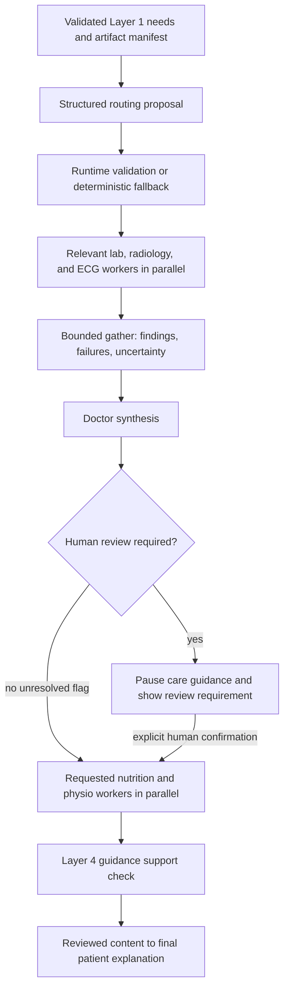

# Layer 2 — Routing and orchestration

**Status:** Adopted revision, 2026-10-23  
**Purpose:** Map Layer 1 information needs to registered workers and execute a bounded workflow.  
**Implementation direction:** LangGraph Graph API in one application runtime.

This document replaces the earlier comparison summary and is the authoritative Layer 2 contract. No separate layer-2/README.md is required.

## Ownership

Layer 1 decomposes the patient's request. Layer 2 routes those existing needs and owns execution order, limits, state, and handoff events. Workers perform the specialist work. The router does not decompose the request again or make medical findings.

Use one structured LLM routing call, initially with configurable Claude Sonnet 4.6 through Bedrock. The LLM proposes assignments from a fixed registry. Application code validates and dispatches them. Known-modality deterministic routing provides fallback when that call fails.

## Worker registry

| Worker | Job | Allowed evidence |
| --- | --- | --- |
| lab | Explain supplied laboratory results | Relevant text or lab-report images |
| radiology | Review supplied radiology evidence | Relevant images and context |
| ecg | Review supplied ECG evidence | ECG images and relevant text; waveform adapter deferred |
| nutrition | Produce requested nutrition discussion points | Combined findings and relevant patient context |
| physio | Produce requested movement/exercise discussion points | Combined findings and relevant patient context |

Physio means the movement and exercise role. Specialist model/tool selection remains a later architecture decision. A model prompt labeled as a specialist does not by itself establish clinical capability.

Add a bounded Doctor synthesis node to combine findings, identify disagreements and gaps, and explain the whole picture. It is separate from the five workers and does not need its own service or autonomous agent loop.

The initial harness can implement these as bounded workers with a common interface. Independent agent loops are deferred. [Layer 4](04-doctor-synthesis-and-evidence-review.md) defines Doctor decisions, scoped nutrition/physio knowledge access, and the guidance support gate.

## Execution flow



Skip stages with no relevant work. A lab-only request invokes lab, synthesis, and final presentation. General text questions can reach synthesis without pretending patient tests exist. A nutrition-only or exercise-only request can use available context after synthesis establishes the limitations.

A lack of flags is not clinical clearance. Preserve the prototype boundary in the patient-facing output.

## Routing proposal

```json
{
  "assignments": [
    {
      "need_id": "need-1",
      "worker": "lab",
      "artifact_ids": ["artifact-lab"],
      "reason": "The need concerns the supplied lab report."
    },
    {
      "need_id": "need-2",
      "worker": "radiology",
      "artifact_ids": ["artifact-xray"],
      "reason": "The need concerns the supplied radiology image."
    },
    {
      "need_id": "need-3",
      "worker": "ecg",
      "artifact_ids": ["artifact-ecg"],
      "reason": "The need concerns the supplied ECG image."
    },
    {
      "need_id": "need-4",
      "worker": "nutrition",
      "artifact_ids": [],
      "reason": "Nutrition guidance was requested after combined interpretation."
    },
    {
      "need_id": "need-4",
      "worker": "physio",
      "artifact_ids": [],
      "reason": "Exercise guidance was requested after combined interpretation."
    }
  ],
  "synthesis_need_ids": ["need-4"],
  "unresolved_need_ids": [],
  "uncertainty_notes": []
}
```

The runtime always synthesizes completed specialist work. synthesis_need_ids identifies needs explicitly requesting a combined answer; it is not permission to omit synthesis.

## Runtime validation

Before dispatch:
- Accept only registered worker names and known need/artifact IDs.
- Check each selected worker can consume the supplied evidence.
- Require every need to be assigned, covered by synthesis, or explicitly unresolved.
- Preserve Layer 1 dependencies and apply the fixed stage order.
- Combine multiple needs for the same worker into one bounded invocation.
- Invoke only relevant workers; never invoke all five by default.
- Pass only the worker's required context and artifacts.
- Reject executable instructions, arbitrary tool names, and model-generated storage paths.

Code resolves artifact IDs through the authoritative manifest. The routing model sees references; the relevant specialist receives actual bytes or extracted evidence.

For a clear known modality, fallback maps lab_report to lab, radiology_image to radiology, and ecg_image to ecg. Unknown images remain unresolved until clarified. Fallback must not infer nutrition or exercise intent solely from the presence of a medical test.

## Common worker interface

Input:
- run_id and task_id;
- assigned need IDs and questions;
- relevant patient text/context;
- permitted artifact references;
- upstream findings for dependent workers;
- configured timeout and call budget.

Output:
- worker and task_id;
- status: succeeded, partial, failed, or timed_out;
- findings with evidence references;
- uncertainty and limitations;
- missing information;
- red_flags with evidence references;
- brief explanation of the result;
- error details suitable for logging when applicable.

Return evidence and concise explanations, not hidden chain-of-thought. A failed result must never be converted into an empty successful finding.

## Gather, synthesis, and final answer

Run independent lab, radiology, and ECG work concurrently. Gather waits until selected workers finish or reach configured deadlines. Preserve completed results when another worker fails; mark late results and prevent them from silently changing an already finalized response.

Synthesis:
- combines available findings without inventing missing results;
- preserves source references and uncertainty;
- exposes contradictions instead of selecting an unsupported winner;
- identifies review requirements and context for downstream workers.

Nutrition and physio run only when requested and dependencies permit. Missing evidence may require withholding individualized guidance while returning a clear limitation.

The final assembly combines the synthesis and available downstream outputs into one explanation: what was reviewed, what was found, what it may mean, what remains unknown, and questions or next steps for human review. It must not introduce new medical conclusions.

## Human review and failures

Record red flags as soon as any worker reports them. The runtime can pause downstream care guidance immediately; it does not have to wait for every worker. Synthesis can add review requirements but cannot erase existing ones without explicit resolution.

Persist a needs_human_review outcome when flagged. Resume only through an explicit review action bound to the run and the findings reviewed. No model may approve its own escalation. If the demo has no review-resume UI, end with the review requirement and available explanatory findings.

Specialist failures produce visible limitations and clinical re-evaluation messages. Do not silently retry indefinitely, substitute invented findings, or crash the entire run.

## Bounds and terminal outcomes

Initial limits:
- one routing LLM call, with no model-repair loop;
- up to three concurrent diagnostic workers;
- up to two concurrent downstream workers;
- one invocation per selected worker after batching its needs;
- no recursive delegation or supervisor replanning;
- configurable worker and run timeouts;
- no automatic worker retries in the first harness.
- one run-wide retrieval recovery grant under Layer 3's policy; this permits a bounded retrieval subroutine, not a second full worker invocation or model-repair loop. Record the owner task and consumed grant in run state; allocate competing requests deterministically and reject additional rounds.

Allow at most one initial Doctor review, one revised review after granted retrieval, and one support check after requested nutrition/physio outputs. No automatic specialist re-analysis is enabled. Choose and test concrete timeout/token limits during harness setup. Cancellation stops scheduling new work and attempts to cancel active calls where supported.

Terminal outcomes:
- completed;
- partial;
- needs_clarification;
- needs_human_review;
- unsupported;
- failed;
- cancelled.

Runtime determines the final outcome. Review requirements take precedence over normal completion, even when explanatory results are available.

## Shared state and LangGraph reducers

Use Python `Annotated` reducers for fields that multiple parallel nodes can update in the same graph step. Ordinary state fields remain single-writer fields. Reducers combine data; they do not determine clinical agreement, authorize actions, or allocate budgets.

| Field | Merge/ownership policy |
| --- | --- |
| evidence_packages | Immutable records keyed by run/task/version ID; merge contributions |
| handoff_events | Immutable records keyed by unique event ID; merge contributions |
| red_flags | Immutable records keyed by flag ID; merge without deleting flags |
| recovery_requests | Immutable requests keyed by request ID; orchestrator arbitrates |
| doctor_review | Single writer: scheduled Doctor review node; preserve versions in history |
| recovery_grant | Single writer: orchestrator; allocated once per run |
| human_review_records | Written only through the authorized review path |
| final_response | Single writer: final-generation node |

Illustrative state declaration; replace generic dictionaries with the harness's validated record types:

```python
from typing import Annotated, Any, TypedDict


def merge_records(existing: dict[str, Any], incoming: dict[str, Any]):
    merged = dict(existing)
    for record_id, record in incoming.items():
        if record_id in merged and merged[record_id] != record:
            raise ValueError(f"Conflicting immutable record: {record_id}")
        merged[record_id] = record
    return merged


class WorkflowState(TypedDict):
    run_id: str
    original_request: dict[str, Any]
    artifact_manifest: dict[str, Any]
    knowledge_snapshot: dict[str, Any]
    intake: dict[str, Any]
    routing: dict[str, Any]
    tasks: dict[str, Any]
    limits: dict[str, Any]
    runtime_status: str
    observability: dict[str, Any]
    evidence_packages: Annotated[dict[str, Any], merge_records]
    handoff_events: Annotated[dict[str, Any], merge_records]
    red_flags: Annotated[dict[str, Any], merge_records]
    recovery_requests: Annotated[dict[str, Any], merge_records]
    doctor_review: dict[str, Any] | None
    doctor_review_history: dict[str, Any]
    guidance_check: dict[str, Any] | None
    reviewed_content_bundle: dict[str, Any] | None
    recovery_grant: dict[str, Any]
    human_review_records: dict[str, Any]
    answer_sections: list[dict[str, Any]]
    generation_status: str
    final_response: str | None
```

Initialize reducer maps to empty dictionaries. Workers return only their new records, for example `{"evidence_packages": {"run-001:lab-task-001:v1": package}}`; never return the entire accumulated map as a new contribution. Revised results use new version IDs. Identical repeated records deduplicate; different payloads sharing one immutable ID are integrity errors, not last-writer-wins updates.

For valid immutable records, the merge is deterministic, associative, commutative by map contents, and idempotent. Do not mutate input state, perform I/O, create timestamps, or call models inside reducers. Construct IDs and timestamps in the producing node. Sort records explicitly for display; map/list merge order is not execution chronology.

`Annotated[list, operator.add]` can accumulate simple lists, but does not deduplicate repeated contributions. Prefer ID-based records for evidence and audit events. If chat messages are later introduced, use the appropriate message reducer rather than treating clinical evidence as chat history.

A reducer error should surface as a controlled integrity failure in the harness. Different clinical interpretations with distinct IDs remain valid parallel records for Doctor review; they are not reducer collisions. Preserve red flags and store authorized resolutions separately. A reducer cannot clear a flag or grant recovery.

Keep routing/synthesis behind explicit gather barriers. Reducers do not make an unfinished worker complete, cancel active calls, or guarantee immediate safety interruption. Runtime scheduling/streamed event handling must implement the early red-flag behavior described above.

Harness checks: merge parallel lab/radiology/ECG updates without loss; verify identical replay deduplication and conflicting-ID rejection; confirm order-independent map contents; confirm only the orchestrator writes the recovery grant; preserve flags after later worker updates.

Reference: [LangGraph state and reducers](https://github.com/langchain-ai/docs/blob/main/src/oss/langgraph/graph-api.mdx).

## Visible handoff events

Use [Layer 5's event and trace contract](05-generation-streaming-and-tracing.md) for live decomposition, question-to-worker assignments, retrieval, evaluation, recovery and generation. Persist events before publishing to the SSE timeline. Instrument actual node/tool execution; never infer success from display order. The one recovery grant includes one structured query-generation call for paraphrase, step-back and HyDE plus the bounded retrieval/reranking round.

Emit events for dispatch, completion, failure, timeout, and review pauses. Include run_id, task_id, source, destination, delegated job, need IDs, input references, output references, uncertainty, status, and timestamps.

Use actual sources such as orchestrator or doctor_synthesis; do not invent persona-to-persona exchanges. The demo should show at least two real specialist handoffs and how they contribute to the final explanation.

## Acceptance checks for the harness

- Three relevant modalities dispatch concurrently.
- Lab-only requests never invoke unrelated workers.
- Nutrition and physio wait for synthesis and review gating.
- Multiple needs for one worker are batched.
- Unknown routes and artifact IDs cannot dispatch.
- Router failure uses bounded deterministic fallback.
- An unknown image requests clarification.
- Failed or timed-out workers remain visible in partial results.
- A red flag prevents unconfirmed downstream care guidance.
- One patient scenario displays at least two real handoffs and a combined answer.

## Deferred

Final specialist adapter evaluation, unbounded retrieval/evaluator loops, AgentCore deployment, separately deployed services, and autonomous supervisor or swarm behavior. The bounded retrieval and review steps in Layers 3–4 are part of the baseline.

## State schema after Layer 02

Layer 02 extends the existing intake state with the execution plan and runtime controls. These fields remain runtime-owned throughout Layers 03–05; later models propose outcomes but cannot directly change permissions, budgets or terminal status.

| State field | Type | Meaning / write policy |
| --- | --- | --- |
| `routing` | `ValidatedRouting` | Validated `assignments`, `synthesis_need_ids`, `unresolved_need_ids`, `uncertainty_notes`, plus runtime-recorded routing method (`model` or `fallback`). Single routing-commit writer. |
| `tasks` | `dict[task_id, TaskRecord]` | Worker, assigned need/artifact IDs, dependency task IDs, lifecycle status, deadlines and selected output package IDs. Orchestrator-only updates; workers emit results/events instead of modifying this shared map. |
| `limits` | `RunLimits` | Configured call/concurrency/time/token/retrieval caps. Runtime-owned; workers receive only their applicable allowance. |
| `runtime_status` | `str` | Active scheduling phase or terminal outcome from the bounds section. Separate from `intake.status` and each worker's status. Orchestrator alone decides. |
| `recovery_grant` | `RecoveryGrant` | `status` (`available`, `allocated`, `consumed`), `grant_id`, owner task/request IDs and usage. Initialize available; runtime allocates at most once. Never use a reducer to allocate grants. |
| `evidence_packages` | `dict[package_id, EvidencePackage]` | Initially `{}`; parallel worker/supplement outputs merge under immutable run/task/version IDs. `Annotated[..., merge_records]`. |
| `handoff_events` | `dict[event_id, WorkflowEventRef]` | Initially `{}`; immutable event summaries/references contributed by nodes. `Annotated[..., merge_records]`. Full event journal is persisted separately. |
| `red_flags` | `dict[flag_id, RedFlag]` | Initially `{}`; source-linked concerns accumulate and cannot be erased by later workers. `Annotated[..., merge_records]`. |
| `recovery_requests` | `dict[request_id, RecoveryRequest]` | Initially `{}`; immutable gap, task/need IDs and requested evidence. Multiple proposals may merge, but only runtime grants one. `Annotated[..., merge_records]`. |
| `human_review_records` | `dict[review_action_id, HumanReviewRecord]` | Initially `{}`; only the authorized review path adds records bound to evidence versions, reviewer action, time and permitted scope. No model writes these records. |
| `observability` | `ObservabilityContext` | `trace_id`, event/span journal references and health status. Initialized before intake; journal service owns health updates. No credentials or raw medical artifacts. See Layer 05. |

Initialize future single-writer outputs (`doctor_review`, `guidance_check`, `reviewed_content_bundle`, `final_response`) to `null`, `doctor_review_history` to `{}`, `answer_sections` to `[]`, and `generation_status` to `not_started`. The `TypedDict` above is illustrative; the harness must validate concrete record types. Initialization, routing, review and generation write at their scheduled stages, not simultaneously to the same field.

**Next handoff:** construct one restricted `WorkerInput` per selected task from this state. Do not send every worker the whole state, other workers' transcripts, or the event journal. A gather barrier selects explicit package versions for Doctor review; dictionary insertion order never selects the latest result.
