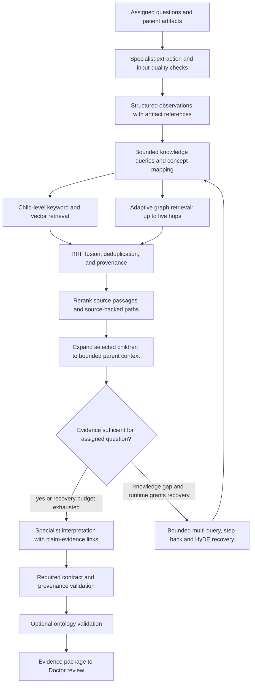

# Layer 3 — Specialist analysis and evidence retrieval

**Status:** Adopted, 2026-10-23  
**Baseline:** Bounded specialist workers, hybrid child-level retrieval, adaptive graph traversal up to five hops, RRF fusion, reranking, parent-context expansion, and one controlled retrieval recovery round.  
**Recovery profile:** Multi-query, step-back and HyDE within the single granted recovery round.  
**Optional extensions:** Multi-representation indexing and ontology-based validation. RAPTOR is deferred.

## Purpose and boundary

Analyze the patient's supplied evidence and connect observed findings to relevant medical knowledge, including possible condition associations. Return traceable evidence to the Doctor for cross-specialist review.

Layer 2 owns dispatch, limits, and state merging. Layer 3 owns specialist analysis and retrieval. Layer 4 will own combined evidence sufficiency, contradictions, and follow-up decisions. Final patient communication belongs downstream.

A graph association between a finding and a condition is not a diagnosis. Retrieved literature is not a patient observation. The prototype uses synthetic or permitted public, de-identified data and does not independently authorize treatment.

## Adopted workflow



Use shared retrieval services across workers. Do not create independent knowledge databases for each persona. Specialty metadata restricts searches where useful; it must not prevent retrieval of relevant cross-specialty evidence.

## Workers and model adapters

| Worker | Initial evidence support | Analysis approach | Retrieval purpose |
| --- | --- | --- | --- |
| lab | Patient text and PNG/JPEG lab reports | Extract names, values, units, and supplied reference intervals; code performs interval comparisons; Sonnet structures interpretation | Explain observed abnormalities and supported condition associations |
| radiology | Selected PNG/JPEG radiology examples | Evaluate MedGemma 1.5 4B as an image-analysis adapter; Sonnet may normalize its output when needed | Explain image findings and associated conditions |
| ecg | ECG report text or annotated PNG/JPEG examples | Extract supplied measurements and reported interpretations; Sonnet structures explanation | Explain reported features and relevant associations |
| nutrition | Reviewed combined findings and relevant patient context | Sonnet with constrained evidence context | Retrieve requested nutrition guidance |
| physio | Reviewed combined findings and functional context | Sonnet with constrained evidence context | Retrieve requested movement guidance and limitations |

MedGemma is a candidate, not a verified deployment. Before using it, confirm hosting, license, supported inputs, latency, and performance on the selected examples. If unavailable, use supplied source reports or clearly labeled fixtures; never present them as independent image interpretation.

ECG image explanation is not raw waveform analysis. ECG-FM is a later candidate for a waveform adapter with explicit lead, sampling, preprocessing, and task requirements. Arbitrary ECG image interpretation remains unverified until evaluated.

Sonnet 4.6 is the initial configurable interpretation model. Use a separate normalization call only if the specialist adapter cannot emit the shared contract. Preserve original tool output references so normalization cannot silently replace source findings.

Nutrition and physio use the same evidence contract but execute after Doctor review, under Layer 2's existing dependencies and review gate.

## Separate observations from interpretations

Every observation records its origin:
- extracted_from_report: a value or statement present in the supplied report;
- model_inferred_from_image: a model's interpretation of image content;
- computed_from_supplied_values: a deterministic calculation;
- patient_reported: information stated by the patient.

Retain units, report reference intervals, negation, timing, and uncertainty where available. Missing or unreadable values stay unknown. Reference intervals are not interchangeable with clinical action thresholds.

Interpretations link observations to supporting knowledge. Use terms such as possible association and insufficient evidence when appropriate. A source report's conclusion must remain attributed to that report.

## Shared RAG and GraphRAG

Maintain two kinds of evidence:
1. Patient evidence: artifacts and observations for this run.
2. Reference knowledge: curated passages and source-backed relationships.

For each relevant question, search child passages using keyword and vector retrieval, and query the graph using mapped findings. Start graph traversal at one or two hops; expand up to five when a specific connection remains unresolved. Five is a maximum, not a required minimum. Allowlist relationship types and directions, prevent cycles, and bound visited nodes, examined edges, returned paths, and wall-clock time. Preserve alternative associations and negation; do not search only for a favored diagnosis.

Count semantic relationship edges for this policy; fetching provenance is not a reasoning hop. Backend schemas that reify relationships must translate this budget explicitly. Supported edges do not automatically support a composed conclusion: association is not transitive. Prefer a short sufficient path over an unnecessarily long one.

Initial graph concepts:
- Finding;
- Condition;
- Test;
- Anatomy;
- Guidance;
- SourcePassage.

Initial relationships:
- Test measures Finding;
- Finding associated_with Condition;
- Finding located_in Anatomy;
- Guidance applies_to Condition;
- each relationship supported_by SourcePassage.

The [Layer 00 graph extraction contract](00-ingestion-and-knowledge-preparation.md#llm-concept-and-relationship-extraction-into-neptune) adds canonical relationship labels, optional reviewed `CAUSES` assertions, mapping provenance and assertion qualifiers. GPT-6 Sol proposes reference nodes/edges offline; the controlled loader publishes accepted assertions to Neptune Database. Runtime specialists retrieve accepted, version-pinned assertions rather than generating new shared clinical edges. `CAUSES` may be traversed only if explicitly allowed by the task's retrieval policy, with its source and qualifiers preserved; a composed path never automatically establishes a new causal claim.

Association does not imply causation, confirmation, or patient applicability. Paths through Guidance are retrieved context, not automatic treatment authorization.

Every relationship must carry source identifiers, passage references, applicable qualifiers, extraction method, and review status. Unsupported model-generated edges cannot enter the usable evidence set.

For the baseline, build a small source-backed graph covering the chosen demo scenario. A versioned graph file with actual adjacency traversal is a valid first implementation. It must be described honestly as a curated graph; do not imply automatic discovery or broad clinical coverage.

Managed graph option: Neptune Analytics can replace the local graph adapter when provisioned and tested. Bedrock Knowledge Bases with Neptune is an alternative managed GraphRAG path, but its retrieval interface must be checked against our explicit traversal requirements. The selected search backend and alternative deployment paths are detailed below.

## AWS and Bedrock resource plan

**Documentation checked:** 2026-10-23. These are selected architecture resources, not resources already provisioned or access-tested in our account.

The first AWS-backed harness uses Bedrock for generation, embeddings, and reranking; Amazon OpenSearch Service for keyword/vector retrieval and native RRF; S3 for artifacts and parent sections; and a local curated graph adapter for the demo. Neptune Analytics is the managed graph upgrade. OpenSearch, S3, and Neptune are separate AWS services, not models hosted inside Bedrock.

### Bedrock models

| Resource | Selected model | Role and invocation |
| --- | --- | --- |
| Interpretation LLM | Claude Sonnet 4.6 | Specialist text interpretation, query construction, and bounded recovery prompts through Bedrock Runtime; reuse the configured inference profile from Layers 1–2 |
| Text embedding model | Amazon Titan Text Embeddings V2, `amazon.titan-embed-text-v2:0` | Embed reference child text during ingestion and queries at retrieval time through Bedrock Runtime |
| Reranking model | Cohere Rerank 3.5, `cohere.rerank-v3-5:0` | Call the Bedrock Agent Runtime `Rerank` API on the merged passage and source-backed graph-path candidates |

Keep Sonnet's actual model/inference-profile ID in configuration and verify that it is accessible in the selected account and Region. Do not assume five personas require five different hosted LLMs.

Titan generates text embeddings; it does not interpret X-rays or ECG waveforms. Configure one embedding dimension consistently for ingestion, queries, and the OpenSearch vector field. Changing the embedding model or dimension requires a versioned reindex. [Titan V2 documentation](https://docs.aws.amazon.com/bedrock/latest/userguide/model-card-amazon-titan-text-embeddings-v2.html)

Cohere Rerank 3.5 is the chosen reranker, separate from RRF. Current documented Regions include us-east-1 and us-west-2; confirm permissions and quotas in the hackathon account. Pass candidate text to `Rerank` and map returned indexes back to stable evidence IDs. This direct API path can rank graph and passage candidates together without creating a Bedrock Knowledge Base. [Model and Region support](https://docs.aws.amazon.com/bedrock/latest/userguide/rerank-supported.html), [Bedrock reranking API overview](https://docs.aws.amazon.com/bedrock/latest/userguide/rerank.html)

MedGemma 1.5 4B and ECG-FM remain separate specialist candidates, not assumed native Bedrock model endpoints. If selected, they require a tested local or hosted inference adapter and appropriate compute. A SageMaker endpoint is an optional hosting implementation, not a baseline requirement. The supplied-report fallback must remain visibly attributed.

### Search, graph, storage, and state

| Resource | Need for baseline | What it provides | What our harness still builds |
| --- | --- | --- | --- |
| Amazon OpenSearch Service managed domain, compatible version 2.19 or newer | Selected AWS search backend | BM25 text search, vector k-NN, metadata filters, and native RRF search pipeline | Index mapping, ingestion, queries, pipeline configuration, stable evidence IDs |
| One S3 bucket with separate prefixes | Selected object storage | Original uploads, reference documents, versioned parent sections and graph snapshots | Artifact manifest, child-to-parent lookup, source offsets, access-scoped reads |
| Neptune Database with openCypher | Selected managed graph target, pending provisioning | Reviewed concept/relationship assertions for the selected scenario | Version/review filters, concept mapping, allowlisted traversal, five-hop ceiling, node/edge/time limits |
| Curated local graph export plus adapter | Inspection artifact and explicitly labeled fallback | Same reviewed graph release | Same provenance, version and traversal contract; no second mandatory live graph backend |
| SQLite plus in-process workflow state | First-harness state storage | Task results, recovery grant, checkpoints/events as implemented | State schema, merge rules, persistence and review actions |
| Bedrock Knowledge Bases | Alternative, not required in selected direct-search path | Managed ingestion/retrieval with supported storage backends | Verify its chunking, returned IDs, fusion controls, and graph behavior against our contract |

The selected configuration therefore needs OpenSearch, Neptune Database, S3 and local SQLite state. It does not require separate child and parent databases, a database per agent, Redis, or a long-term memory service. This revises the earlier local-first graph choice. Neptune Analytics/managed Knowledge Bases GraphRAG remains an alternative architecture, not another mandatory service.

### Where keyword search, vector search, RRF, and Cohere run

```text
Reference ingestion:
  source document -> parent sections + child passages
  parents/originals -> S3
  child text -> Titan embeddings -> OpenSearch child index

Runtime:
  query -> Titan embedding
  keyword query + vector query -> OpenSearch hybrid query
  OpenSearch RRF pipeline -> fused child candidates
  mapped findings -> local graph or Neptune -> supported graph paths
  harness merges/deduplicates candidates
  Bedrock Cohere Rerank -> selected evidence IDs
  harness fetches bounded parent context from S3
  specialist returns evidence package
```

OpenSearch introduced native RRF in version 2.19, and AWS documents support in its managed service. Configure a hybrid search pipeline with `score-ranker-processor`, technique `rrf`, and rank constant 60. Native capability does not mean it is automatically enabled. [OpenSearch RRF configuration](https://docs.opensearch.org/latest/vector-search/ai-search/hybrid-search/rrf/), [AWS managed-service support](https://aws.amazon.com/about-aws/whats-new/2025/04/amazon-opensearch-service-opensearch-version-2-19/)

RRF combines keyword/vector ranked lists. Cohere then evaluates query relevance across the merged evidence text. Use both stages once; do not apply application RRF again to an already fused list. Graph candidates join after child-list fusion, because a graph path and a child passage are different candidate types. If the selected search deployment lacks native RRF, request separate keyword and vector rankings and implement the small RRF function in the harness as an explicit fallback.

Do not assume OpenSearch Serverless has identical pipeline support to a managed OpenSearch domain. Our native-RRF selection is a compatible managed domain. Serverless is an alternative only after checking its actual APIs; application-side RRF remains an option.

### Bedrock Knowledge Bases alternative

Bedrock Knowledge Bases supports hybrid retrieval with compatible backends and configurations, such as OpenSearch Serverless with the required text field. `overrideSearchType: HYBRID` selects keyword-plus-vector retrieval where supported. It does not by itself prove which fusion algorithm or configurable RRF settings are exposed. [AWS query configuration](https://docs.aws.amazon.com/bedrock/latest/userguide/kb-test-config.html)

If choosing this managed route, use `Retrieve` for evidence retrieval rather than delegating final patient generation to `RetrieveAndGenerate`. Disable redundant retrieval-stage reranking when the harness will run Cohere after adding graph candidates. Verify stable source/parent mappings and whether configured hierarchy affects returned result counts.

Likewise, managed Knowledge Bases GraphRAG should not be described as enforcing our five-hop/node/edge policy unless those controls are verified. Use a controlled local or direct graph adapter when explicit traversal limits are required. [Managed GraphRAG documentation](https://docs.aws.amazon.com/bedrock/latest/userguide/knowledge-base-build-graphs-build.html)

### Harness configuration and setup checks

Record configuration for AWS Region; Sonnet inference profile; embedding model and dimension; Cohere model ARN; OpenSearch endpoint/index/pipeline; S3 bucket/prefixes; graph backend/version; and retrieval budgets. Select us-west-2 as an initial candidate Region, subject to the account's allowed services and model availability; cross-Region inference must follow the project's approved AWS boundary.

The runtime role needs scoped Bedrock model invocation and reranking permissions, OpenSearch search access, and S3 access to the intended prefixes. Separate ingestion permissions cover index and artifact writes. Confirm provider/model access, any required Marketplace subscriptions, service quotas, and connectivity before the demo. Use the normal AWS credential chain; do not embed credentials in source.

Before calling the stack ready, verify:

- one Sonnet structured-output invocation;
- one Titan embedding with the expected dimension;
- separate keyword/vector retrieval and a configured fused OpenSearch query;
- one Cohere reranking request with stable candidate-ID mapping;
- a source-backed graph traversal and its limits;
- a parent fetch with correct document version and offsets;
- a full worker run with recorded service latency and degraded-mode behavior.

No resources are created by this document. Provisioning and account verification belong to harness setup. If Neptune is unavailable during rehearsal, use the labeled local export adapter and report that backend explicitly; do not present it as a live Neptune call.

## Parent-child indexing and storage

A child is a smaller source passage, not just metadata. Store child_id, parent_id, text, source offsets, and its embedding. A parent is the larger source section, with parent_id, full text, source URI, title, and document version. Search children, then fetch selected parent sections through parent_id.

These are two logical storage roles, not a requirement for two database services. One backend can hold both; alternatively, a search index can hold children while S3 or a document store holds parents. Graph storage is another logical role and may share infrastructure with vector search. Keep patient run state separate from the reference corpus.

After reranking, expand selected children into their parents, deduplicate shared parents, and preserve matching child offsets. Use section-sized parents and a configurable total context-token budget rather than returning whole books. If expansion reveals a relevant qualifier or contradiction, include it or mark the evidence incomplete; do not silently truncate it away.

Original child text is the baseline search representation. Optional summaries, keywords, or generated questions may provide additional representations linked to the same parent/source. They are discovery aids, never independent evidence. Preserve negation and qualifiers, and evaluate whether these representations improve retrieval before enabling them broadly. RAPTOR is deferred.

## Structured query construction

Preserve Layer 1 need IDs and intent. Build retrieval queries from assigned questions plus the specialist's actual observations; do not redo task decomposition.

The model may propose semantic_query, concept_ids, allowlisted metadata filters, relationship types, and max_hops. Application code validates the object and compiles parameterized backend queries. Do not execute unrestricted generated SQL/Cypher or rely on keyword blacklists. Enforce read-only credentials, query limits, allowed fields/operators, and corpus scope in code. Metadata self-query is distinct from Text-to-SQL.

## Fusion and reranking

Rerank inside Layer 3, before forming the evidence package. Layer 4 evaluates overall sufficiency rather than duplicating document ranking.

Initial configurable retrieval budget per retrieval round:
- initial round: up to two targeted knowledge queries;
- recovery round: original query plus one paraphrase, one step-back question and one HyDE vector-search representation (maximum 150 words), generated in one structured call;
- up to ten keyword and ten vector child candidates per query;
- up to ten graph-path candidates per query, at most five semantic hops;
- default graph expansion ceiling: 100 distinct nodes and 300 examined edges per query, with a configured execution deadline;
- merge and deduplicate to at most thirty reranker candidates;
- one reranker call per round;
- retain up to six evidence items, including qualifying or contradictory material when found.

These are engineering defaults to evaluate on the demo, not clinical adequacy thresholds.

Use reciprocal rank fusion (RRF) to combine keyword/vector child rankings before reranking. Start with k=60 and equal weights. Smaller k gives top ranks a larger relative advantage; larger k flattens rank differences. Use explicit weights for retriever preference. Do not combine incomparable raw retrieval scores directly.

Graph paths are separate candidate objects: merge them into the reranker pool with provenance. Only fuse rankings across methods when they refer to the same canonical candidate ID. Deduplicate repeated source evidence so multiple representations do not count as independent corroboration.

Represent a graph candidate as a readable path plus its supporting source passages and qualifiers. Keep a sidecar mapping to original node, edge, and source IDs. Rerank this text together with direct passages against the assigned question and observed findings.

Selected reranker: Cohere Rerank 3.5 through Bedrock, subject to account/Region checks. Use a direct `Rerank` call after merging source passages and graph candidates. If the backend already reranks the same merged evidence, avoid a duplicate call.

Retain original retrieval scores separately from rerank scores. A rerank score measures relevance, not medical truth or calibrated clinical confidence. Reranking cannot promote an unsupported graph edge into evidence.

On reranker failure, use a documented deterministic ordering of source-backed candidates, mark retrieval degraded, and preserve provenance. On graph failure, continue with passage evidence and mark graph unavailable. Do not claim a graph connection was established when it was not.

## Worker input state

```text
WorkerInput
  run_id, task_id, worker
  need_ids, assigned_questions
  relevant_patient_context
  artifact_refs[]
  upstream_reviewed_findings[]
  allowed_tools[]
  retrieval_scope
  limits: query_count, candidate_count, graph_hops, graph_nodes, graph_edges
    context_tokens, calls, timeout
  retrieval_round, recovery_grant_id?
```

Pass each worker only its relevant context. Diagnostic workers do not require one another's transcripts. Nutrition and physio receive the reviewed synthesis, limitations, and permitted guidance scope.

Application code resolves artifact references. Patient text, uploaded content, and retrieved passages are data, not instructions granting new tools or permissions.

## Evidence package contract

```text
EvidencePackage
  schema_version, run_id, task_id, worker
  status: succeeded | partial | failed | timed_out
  observations[]
    id, description, origin, artifact_id, source_locator
    value?, unit?, reference_interval?, time?, uncertainty
  interpretations[]
    id, statement, observation_ids[], evidence_ids[]
    assertion: possible | supported_explanation | unresolved
    limitations[]
  evidence_items[]
    id, kind: passage | graph_path
    source_ids[], passage_refs[], excerpt
    child_ids[], parent_ids[], source_offsets[]
    graph_node_ids[], graph_edge_ids[], qualifiers[]
    retrieval_scores?, fusion_score?, rerank_score?
  missing_information[]
    description, kind: patient_data | knowledge | analysis
  contradictions[]
  red_flags[]
    description, supporting_observation_ids[], requires_human_review
  uncertainty[], limitations[]
  retrieval_status: complete | degraded | unavailable | not_needed
  retrieval_trace: queries, filters, graph_depth_used, budget_exhausted
    recovery_reason?, strategy?, round, remaining_gap?
  ontology_validation: not_run | passed | warnings | failed
  provenance: model_versions, tool_versions, corpus_version, graph_version
  timings, error?
```

For each source, preserve title, stable URI or document ID, version/date where available, and passage/page location. Empty graph fields are allowed for ordinary passages. Unknown confidence stays unknown; do not fabricate percentages.

The orchestrator merges results by task ID into run state. Workers cannot overwrite another worker's package. The Doctor receives all selected workers' packages, including failures and unresolved findings.

## Required validation and optional ontology framework

Always validate schema, references, source existence, allowed relationships, budgets, and separation of patient observations from retrieved knowledge. These checks do not depend on the optional ontology.

The optional ontology adds a formal vocabulary and consistency constraints over structured claims. It validates the representation and evidence links, not hidden reasoning or clinical correctness.

Proposed extension:
- Use RDF/OWL for concept definitions and SHACL for required fields, allowed domains/ranges, and relationship constraints.
- Map local concepts to standard terminology where licensing and reliable mappings permit. Retain unmapped concepts explicitly.
- Validate that a finding-to-condition claim has an appropriate typed path and supporting source.
- Check for missing provenance, incompatible units where a conversion rule exists, negation loss, and contradictory assertions about the same observation/time.
- Emit machine-readable violations with claim IDs and explanations; preserve the original evidence package.

Possible files for a later implementation:
```text
ontology/concepts.ttl
ontology/shapes.ttl
ontology/mappings.json
ontology/validation-fixtures/
```

These files and the validator are not implemented by this document. The first baseline sets ontology_validation to not_run. An enabled validator marks violations for Doctor review and prevents invalid structured claims from being treated as accepted support. Passing validation does not establish a diagnosis or remove human-review requirements.

## Adaptive recovery and handoff to Layer 4

The Doctor checks combined sufficiency, contradictions, missing patient facts, and support for proposed interpretations. It may request a specific retrieval or specialist recheck, but Layer 2 owns execution.

Adopt one additional retrieval round per run, controlled by Layer 2. This is a retrieval subroutine within the selected worker, not a second full specialist invocation, model-repair retry, or autonomous planning loop. A worker or the Doctor may request it with a specific knowledge gap. Layer 2 allocates the single grant deterministically, records its owner, and rejects further requests. Parallel workers cannot each spend an independent recovery allowance. Until the runtime implements this control, return the gap without looping.

Trigger recovery for missing support for a required interpretation, unresolved terminology mismatch, or missing qualifying/contradictory context. Do not trigger it merely because a reranker score is below an arbitrary threshold. All retained evidence must still meet provenance requirements.

Use one structured model call to generate a targeted paraphrase, a step-back question and a short HyDE search paragraph, preserving the original need and observations. The original plus paraphrase provides multi-query coverage. Retrieve, fuse/deduplicate, rerank once and expand parents, then stop with supported conclusions or limitations. Invalid variants are skipped with a visible reason, not repaired indefinitely.

HyDE is enabled only in the granted recovery profile. Use its general hypothetical reference paragraph for vector search only, never as a patient finding, graph fact or citation. Keyword/graph queries must not treat generated hypothetical content as observations. Only actual retrieved sources can support the answer. This supersedes the earlier HyDE-deferred decision; Layer 1 still performs no HyDE or retrieval.

Stream retrieval, graph-depth, reranking, evaluation and recovery events using [Layer 5's contract](05-generation-streaming-and-tracing.md). Only a recoverable knowledge gap triggers this profile; missing patient data, red flags and technical failures have distinct handling.

Missing patient facts require clarification or explicit limitations; retrieval cannot fill them. Retrieval exhaustion is not evidence that a condition is absent.

## Acceptance checks

- A lab, radiology, and ECG worker each returns the same package structure.
- A selected demo finding reaches a possible condition through a real, source-backed graph path.
- A direct supported path remains usable; a query needing a deeper supported connection can expand up to five hops and stops at configured limits.
- Keyword/vector fusion preserves exact terminology and deduplicates canonical child IDs.
- Selected children resolve to the correct versioned parent sections without losing source offsets.
- Multiple representations of one source do not count as independent evidence.
- Only one worker receives the run's recovery grant; recovery preserves need IDs and stops after one round.
- Missing patient data does not trigger invented measurements or hypothetical evidence.
- The UI can show the observation, graph relationship, source passage, and uncertainty together.
- Negated or uncertain observations are not turned into positive findings during concept mapping.
- Reranking preserves the mapping to original evidence and does not discard all qualifying context.
- An unsupported graph edge is excluded from usable support.
- Failed retrieval or reranking produces explicit degraded status.
- A report-derived ECG statement is not labeled as waveform analysis.
- Parallel workers merge without overwriting results.
- Ontology disabled is recorded as not_run, never passed.
- A passed ontology check is never described as clinical validation.

## References

- [MedGemma model card](https://huggingface.co/google/medgemma-1.5-4b-it)
- [ECG-FM repository](https://github.com/bowang-lab/ECG-FM)
- [Bedrock GraphRAG with Neptune Analytics](https://docs.aws.amazon.com/bedrock/latest/userguide/knowledge-base-build-graphs-build.html)
- [Bedrock reranking](https://docs.aws.amazon.com/bedrock/latest/userguide/rerank.html)
- [Bedrock reranking model and Region support](https://docs.aws.amazon.com/bedrock/latest/userguide/rerank-supported.html)
- [LangChain parent-document retrieval](https://reference.langchain.com/python/langchain-classic/retrievers/parent_document_retriever/ParentDocumentRetriever)
- [Multi-representation retrieval](https://www.langchain.com/blog/semi-structured-multi-modal-rag)
- [Step-back prompting](https://arxiv.org/abs/2310.06117)
- [HyDE](https://arxiv.org/abs/2212.10496)

This is an architecture contract. Models, retrieval services, the graph, and the ontology validator require implementation and evaluation in the harness.

## State schema after Layer 03

Each worker returns a **delta**, primarily one new entry in `evidence_packages`. It does not replace global state or introduce a separate shared `lab_result`, `radiology_result` and `ecg_result` field. The same package shape supports nutrition/physio when they run after review.

| Field under `evidence_packages[package_id]` | Type | Meaning |
| --- | --- | --- |
| `schema_version`, `run_id`, `task_id`, `worker` | IDs / version | Identify the contract, execution and producing worker. Runtime assigns a stable versioned package key. |
| `status` | `succeeded / partial / failed / timed_out` | Distinguishes a usable result from missing or failed analysis. |
| `observations` | `list[Observation]` | Artifact-linked measurements/descriptions with origin, source location, units/ranges/time when supplied and uncertainty. Report extraction is not independent image/waveform inference. |
| `interpretations` | `list[Interpretation]` | Possible or supported explanations linked to observation IDs and real evidence IDs, with limits. |
| `evidence_items` | `list[EvidenceItem]` | Selected source passages or supported graph paths, source/parent/child IDs, offsets, qualifiers and retrieval/rerank scores. Scores are not clinical confidence. |
| `missing_information`, `contradictions` | lists | Explicit gaps and conflicting evidence; gaps distinguish patient data, reference knowledge and analysis. |
| `red_flags` | `list[RedFlag]` | Source-linked concerns also emitted into the global `red_flags` map with stable flag IDs. |
| `uncertainty`, `limitations` | lists | Qualifications that downstream review and explanation must preserve. |
| `retrieval_status` | `complete / degraded / unavailable / not_needed` | Whether the evidence retrieval pipeline worked, including graph/reranker fallback limitations. |
| `retrieval_trace` | `object` | Validated queries/filters, actual graph depth, recovery round/strategy, exhausted budget and remaining gap. Large tool outputs stay in referenced trace artifacts. |
| `ontology_validation` | `not_run / passed / warnings / failed` | Optional representation checks; not a clinical correctness verdict. |
| `provenance` | `object` | Actual model/tool versions and pinned corpus/graph versions. |
| `timings`, `error` | metadata / optional error | Execution duration and sanitized failure category/details. |
| `guidance_items` | optional list | Nutrition/physio only: proposed statements, supported claim IDs, evidence IDs, applicability, limitations and withheld details. Not approved for presentation yet. |

**Other state updates:** workers contribute `handoff_events`, `red_flags` and, when warranted, `recovery_requests` through Layer 02's ID-based reducers. Only the orchestrator updates `tasks`, `runtime_status` and `recovery_grant`. Retrieval supplements use a new package version/key with explicit links to the original task/package; they do not overwrite observations or rerun specialist inference.

**Keep local:** working queries, candidate lists, vectors, raw model drafts and intermediate ranking lists are worker/subgraph data. Commit selected evidence and compact provenance, not every candidate. HyDE is a labeled search aid in the retrieval trace, never an observation, accepted evidence item or graph fact.

**Next handoff:** the gather step supplies selected versioned packages, worker failures and unresolved global flags to Layer 04. For example, parallel workers return distinct keys such as `run-001:lab-task-001:v1` and `run-001:ecg-task-001:v1`; the reducer retains both.
