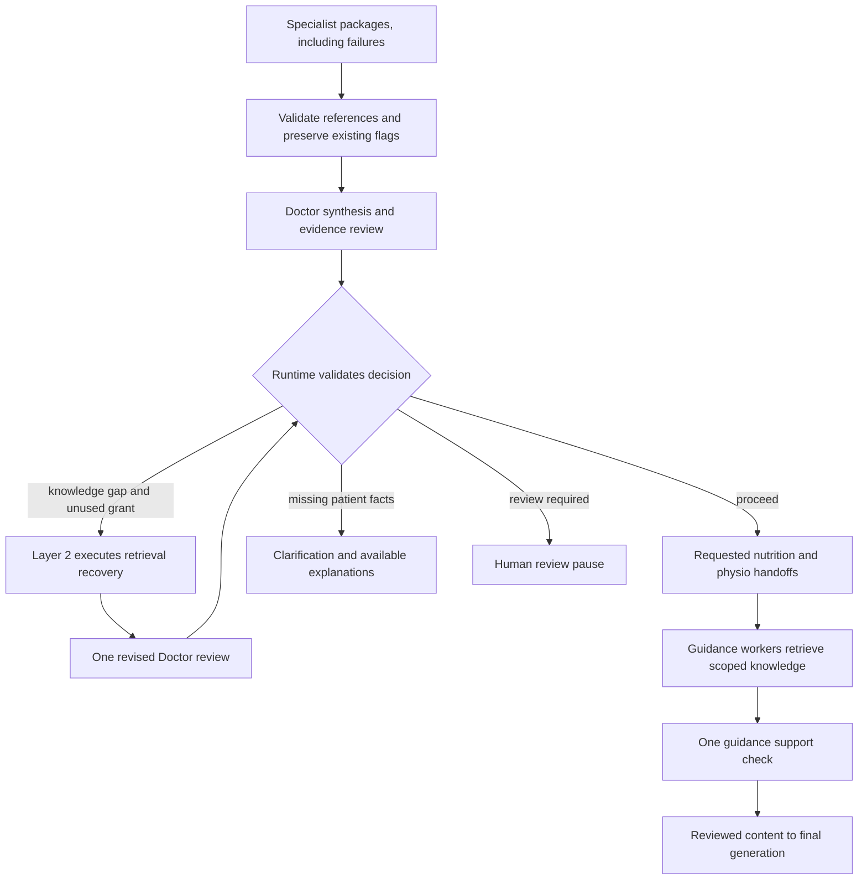

# Layer 4 — Doctor synthesis and evidence review

**Status:** Adopted, 2026-10-23. Architecture contract; executable nodes remain for the harness.  
**Model:** Configurable Claude Sonnet 4.6 through Amazon Bedrock with structured output.  
**Purpose:** Combine specialist evidence, assess support and gaps, and prepare nutrition/physio handoffs.

## Ownership

Layer 3 analyzes evidence and retrieves knowledge. Layer 4 reviews the combined result. Layer 2 owns scheduling, budgets, pauses and state. Layer 5 will execute requested guidance work and assemble the patient-facing response.

The Doctor is a bounded review node, not an autonomous supervisor or clinical authority. Proceed means sufficient support for the stated explanatory scope, not a confirmed diagnosis or clinical clearance.

## Flow



Runtime state bounds the recovery cycle: one run-wide retrieval grant and at most one revised review. Human confirmation, if implemented, re-enters runtime validation with an explicit permitted scope; it does not authorize unrestricted guidance.

## Input and review procedure

```text
DoctorReviewInput
  run_id, review_id, review_version
  original_request, need_ids[], requested_outcomes[]
  relevant_patient_context
  diagnostic_packages[]       # Layer 3 EvidencePackage
  worker_failures[], existing_red_flags[]
  existing_human_review_record?
  corpus_version, graph_version
  retrieval_recovery: available | allocated | consumed
  remaining_budgets
```

Supply compact observations, interpretations, selected source excerpts and citations. Keep raw artifact references accessible through controlled tools without copying every image or transcript into the prompt.

The runtime first verifies run IDs, reference existence, corpus versions and worker statuses. The Doctor then:

1. Maps each original need to available observations and claims.
2. Distinguishes patient reports, extracted report statements, image-model inferences and computed values.
3. Combines related observations without losing uncertainty or treating graph association as causation.
4. Checks source support and applicability, including timing, units, negation and population qualifiers.
5. Records contradictions rather than silently selecting the most confident worker.
6. Classifies gaps as patient_data, reference_knowledge, specialist_analysis or source_conflict.
7. Proposes a decision with explicit downstream scope.

Sufficiency is assessed per claim/need. Reranker scores, model confidence, majority vote and ontology passes do not establish clinical correctness. Code checks references; model support judgments still need evaluation.

## Decisions

| Decision | Meaning | Runtime behavior |
| --- | --- | --- |
| proceed | Enough support for the requested explanation within stated limits | Dispatch only requested workers with permitted scope |
| retrieve_more | A specific knowledge gap may be resolved from references | Grant the remaining retrieval round or reject if already used |
| clarify | A material patient fact/artifact is missing | Ask a focused question and pause dependent work |
| human_review | Red flags or material unresolved conflict prevents guidance | Preserve available findings and pause care guidance |

An explanation may proceed with partial coverage. General educational questions do not require nonexistent patient tests. Never represent missing results as normal findings.

Unresolved review flags override proceed. Do not delay a required pause while searching for reassuring evidence. Missing patient measurements require clarification, not retrieval. Malformed review output or invalid references produces a visible failure and withholds dependent individualized guidance; never default to proceed.

## Output contract

```text
DoctorReview
  run_id, review_id, review_version
  status: complete | partial | failed
  combined_summary
  supported_explanations[]
    claim_id, statement, observation_ids[], evidence_ids[]
    applicability, uncertainty, limitations[]
  need_coverage[]
    need_id, state: supported | partial | unresolved, claim_ids[]
  contradictions[]
    claim_ids[], description, impact, resolution?
  missing_patient_information[], unresolved_questions[], red_flags[]
  decision: proceed | retrieve_more | clarify | human_review
  decision_reason
  follow_up_request?
    target_need_ids[], target_worker, gap_type, question
    required_evidence, stop_condition
  nutrition_context?, physio_context?
  corpus_version, graph_version
```

Store immutable review versions. The Doctor cannot overwrite specialist packages, forge human confirmation, or clear an existing flag without an explicit resolution.

## Recovery and call limits

Use one initial Doctor call. If Layer 2 grants retrieval recovery, preserve previous evidence and contradictions, add the new evidence, and allow one revised review. The grant is shared with Layer 3; it is not an additional allowance.

Recovery calls a targeted retrieval adapter against stored observations, even if the original worker invocation has finished. Store a versioned evidence supplement; do not invent new patient observations or rerun the entire worker.

Fresh specialist inference is a different action. In this baseline, an unresolved specialist_analysis gap becomes a limitation or human-review requirement. Automated image/waveform re-analysis remains deferred until explicitly budgeted.

Allow one support-check call after nutrition/physio outputs if either worker ran. It cannot initiate another recovery cycle. Maximum Layer 4 calls: initial review, conditional revised review, conditional guidance check. Exhaustion must not approve unchecked guidance.

## Nutrition and physio knowledge bases

Both workers need retrieved support for substantive guidance. Reuse Layer 3's shared OpenSearch corpus, graph adapter, Titan embeddings, RRF and Cohere reranking. Use separate logical knowledge scopes, not separate database deployments or mandatory Bedrock Knowledge Base resources.

The [Layer 00 manifest](00-ingestion-sources.json) already selects these sources:

| Worker | Primary sources | Contextual sources when applicable | Initial coverage |
| --- | --- | --- | --- |
| nutrition | ref-foods, ref-hf-living | ref-bmp, ref-potassium, ref-bnp, ref-hf-diagnosis | General food-pattern education and care-team discussion points |
| physio | ref-activity, ref-hf-living | ref-hf-symptoms, ref-hf-diagnosis, ref-ecg | General activity education, limitations and discussion points |

Primary pages: [NHLBI heart-healthy foods](https://www.nhlbi.nih.gov/health/heart-healthy-living/healthy-foods), [physical activity](https://www.nhlbi.nih.gov/health/heart-healthy-living/physical-activity), and [living with heart failure](https://www.nhlbi.nih.gov/health/heart-failure/living-with).

This is a starter educational corpus. It does not establish individualized rehabilitation protocols, therapeutic diets, supplement regimens, fluid/sodium prescriptions or exercise clearance. Record gaps and withhold unsupported specifics. Later expansion should add selected applicable guidelines with rights, dates, population qualifiers and review.

Ingestion adds multi-valued retrieval_scopes to source/parent/child metadata. Shared sources belong to multiple scopes; specialty remains descriptive. A source tagged specialty=synthesis must not be excluded from nutrition or physio when explicitly permitted by its scope.

Preserve document_type, source_id/date, corpus_role/version and stated applicability. Unknown metadata remains unknown. Hard filters enforce reference_knowledge and the run's pinned version. Retrieval uses the union of primary and contextual source scopes, with any expansion logged.

Missing primary sources produce partial/unavailable knowledge coverage. Model memory cannot silently replace unavailable references with an uncited plan.

## Guidance handoff

```text
GuidanceContext
  run_id, review_id, review_version, need_ids[], requested_questions[]
  supported_claims[]          # IDs, statements and evidence links
  relevant_patient_context
  uncertainty[], missing_information[], restrictions[]
  unresolved_red_flags[], human_review_scope?
  permitted_output: general_education | bounded_guidance | withheld
  retrieval_scope: primary_source_ids[], contextual_source_ids[]
  corpus_version, graph_version, tool_limits
```

Nutrition receives supplied dietary preferences, allergies, medications and relevant lab context where available. Physio receives supplied symptoms, function/mobility, activity tolerance and explicit clinician restrictions where available. Unknown fields remain missing. Neither may infer clearance from a normal-looking test or confirm a condition from graph associations.

Create contexts only for requested workers when runtime gating permits. They may execute in parallel after review. Each returns Layer 3's EvidencePackage plus guidance_items with statement, supported_claim_ids, evidence_ids, applicability, limitations and withheld_details. General education is explicitly labeled. New flags immediately propagate to runtime.

## Guidance check and final-generation handoff

Validate guidance IDs in code, then use one bounded support-check call to compare proposed guidance with reviewed findings, restrictions and retrieved references.

Per-item outcomes: accepted_for_presentation, qualified, withheld, human_review. A qualified item includes a supported replacement statement; otherwise withhold it. A confident rewrite cannot repair missing evidence.

Return a ReviewedContentBundle with explanations, accepted/qualified guidance, citations, withheld-item reasons, missing information and flags. Reviewed means checked by the prototype, not clinician-approved. Final generation cannot add a diagnosis, prescription, dosage or unsupported activity recommendation.

If the check fails, retain prior supported explanations and show guidance unavailable. Mark the run partial or needs_human_review as appropriate instead of publishing unchecked outputs.

## State and visible events

Follow [Layer 2's reducer and ownership contract](02-planner-orchestrator-and-routing.md). Parallel worker evidence, flags and requests merge by immutable ID. The scheduled Doctor node writes the current review; the orchestrator alone allocates recovery. Clinical disagreement is resolved in review, not by reducers. Human flag resolutions remain separate authorized records.

Persist review versions, need coverage, gaps, recovery ownership, contexts, support-check outcomes and decisions. Human review records bind reviewer action and permitted scope to the exact run/evidence version and timestamp. Changed evidence may require renewed review.

Emit doctor_review_started/completed, retrieval_requested/granted/denied, clarification_requested, human_review_required, guidance_dispatched and guidance_checked events. Link events to evidence IDs and short explanations, not hidden chain-of-thought.

Normalize these event names through [Layer 5's envelope](05-generation-streaming-and-tracing.md). Stream evidence-check verdicts, the specific support gap, grant decision and recovery outcome. Display enough support as permission to continue within scope, never as confirmed diagnosis. Recovery query generation is charged to Layer 3's single shared grant, separate from the Doctor review-call ceiling.

Without a review/resume UI, the baseline ends in needs_human_review and presents available explanations with the unresolved limitations.

## Acceptance checks

- Combine multiple workers' findings with provenance intact.
- Preserve failures and contradictions in need coverage.
- Missing patient facts trigger clarification rather than invented values.
- Respect the shared recovery grant and one-review-revision limit.
- Existing unresolved red flags override proceed.
- Nutrition and physio retrieve their primary and shared contextual sources.
- Shared-source access works despite specialty=synthesis.
- Missing guidance sources result in explicit limited coverage.
- Workers receive the correct review version and permitted scope.
- Unsupported or conflicting guidance is withheld, qualified or escalated.
- No unrequested guidance worker executes; final generation receives only reviewed content.

## Remaining work

Implement schemas, prompts, runtime validators, retrieval supplements and state transitions. Populate/evaluate the source corpus. Layer 5 defines the final presentation/UI contract; this document specifies its inputs and support gate.

## State schema after Layer 04

Review adds a combined assessment without modifying specialist packages. The guidance workers reuse Layer 03's package contract; this layer owns their review/handoff contracts and the subsequent support check. Layer 02 schedules the nodes, and Layer 05 presents only the reviewed result.

| State field | Type | Meaning / writer |
| --- | --- | --- |
| `doctor_review` | `DoctorReview or null` | Current validated review, including run/review/version IDs and status. One scheduled Doctor-review commit writer; runtime validates before acting. |
| `doctor_review_history` | `dict[review_id:version, DoctorReview]` | Immutable initial/revised review snapshots. Same serialized review-commit writer; no parallel reducer needed. |
| `doctor_review.supported_explanations` | `list[ReviewedClaim]` | Statements with observation/evidence IDs, applicability, uncertainty and limitations. |
| `doctor_review.need_coverage` | `list[NeedCoverage]` | Each original need is supported, partial or unresolved, linked to relevant claim IDs. |
| `doctor_review.contradictions` | list | Conflicting claim IDs, impact and any justified resolution; unresolved conflicts remain visible. |
| `doctor_review.missing_patient_information`, `unresolved_questions`, `red_flags` | lists within review | Outstanding facts, questions and safety concerns. New flags also merge into global `red_flags`; this review cannot delete existing flags. |
| `doctor_review.decision`, `decision_reason` | enum / concise text | Proposed `proceed`, `retrieve_more`, `clarify` or `human_review`, with a brief evidence-based explanation. Not executable permission by itself. |
| `doctor_review.follow_up_request` | `object or null` | Target need/worker, gap type, question, required evidence and stop condition. Runtime registers an immutable recovery request and grants/denies it separately. |
| `doctor_review.nutrition_context`, `physio_context` | `GuidanceContext or null` | Only requested, permitted handoffs: review version, supported claims, supplied patient context, restrictions, missing facts, retrieval scope and tool limits. No duplicate top-level context copies. |
| `guidance_check` | `GuidanceCheck or null` | One support-check result: review/package versions checked, status, per-item outcomes and reasons. Outcomes are accepted, qualified, withheld or human-review; qualifications include supported replacement wording. Single support-check commit writer. |
| `reviewed_content_bundle` | `ReviewedContentBundle or null` | Versioned input for final generation: explanations, accepted/qualified guidance, allowed citations, withheld reasons, missing information and flags. One serialized bundle-assembly writer. |

The bundle records `bundle_id`, `bundle_version`, `review_id`, `review_version` and selected `package_ids` so generation cannot accidentally combine mismatched versions. With no guidance requested, assemble it directly from the validated Doctor review. If guidance checking fails, assemble only supported explanations and explicit limitations; never include unchecked guidance.

**Write policy:** reviews, support checks and bundle assembly are scheduled single-writer commits, not parallel reductions. Parallel nutrition/physio packages still use `evidence_packages` and its reducer. Proposed flags/events/requests use the existing shared reducer maps. The orchestrator alone changes `runtime_status` or consumes recovery; authorized human actions alone update `human_review_records`.

**Next handoff:** Layer 05 receives the pinned `reviewed_content_bundle`, original needs and current runtime outcome. It does not receive permission to make new clinical claims. A failed review cannot produce a normal approved bundle; use a runtime-validated limitations-only response or stop generation.
