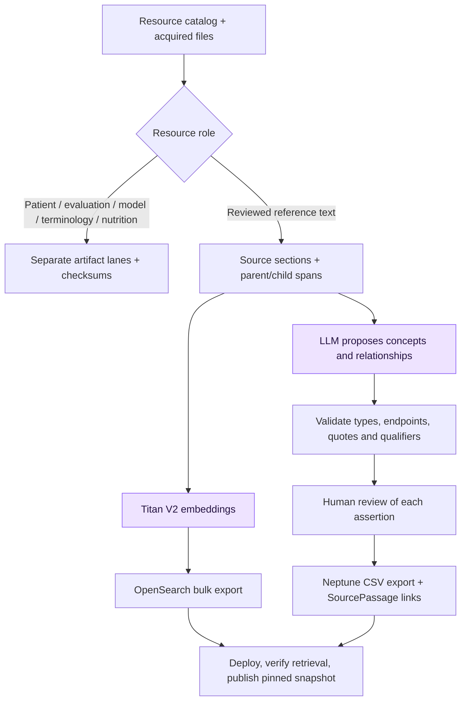

# Ingestion: resources, passages and reviewed graph assertions

## Selected cloud demo path (2026-10-23)

For the one-hour demo, use [managed Bedrock + Neptune Analytics GraphRAG](managed-neptune-graphrag.md), **not the standalone OpenSearch export below**. `python -m ingestion.managed_kb upload` uploads the small authored reference corpus and isolated fictional patient case; `python -m ingestion.managed_kb build` creates a 16 m-NCU Neptune Analytics graph, a scoped Bedrock Knowledge Base role, one Knowledge Base and its S3 data source, and starts a sync. Bedrock handles embeddings, graph construction, and vector/graph retrieval in this managed route. The existing `pipeline.py prepare/extract/embed/export` remains an offline, human-review-oriented alternative; its OpenSearch and Neptune Database CSV outputs are not used by this demo.

This folder implements the first **offline staging pipeline** for [Layer 00](../architecture/00-ingestion-and-knowledge-preparation.md). It includes the [dataset destination map](resources.md), [acquisition and deployment runbook](pipeline.md), and a Python command-line harness. It does not provision AWS services or automatically publish a corpus.

## Cloud services and models

The root [`.env.example`](../.env.example) now lists every ingestion setting. The private `.env` has the same keys. `AWS_REGION=us-east-1`; `GRAPH_MODEL_ID=us.anthropic.claude-sonnet-4-6` is the initial graph concept/edge extractor through Bedrock Converse; `BEDROCK_EMBEDDING_MODEL_ID=amazon.titan-embed-text-v2:0` produces vectors with `BEDROCK_EMBEDDING_DIMENSIONS=1024`. The optional architecture preference `us.openai.gpt-6-sol` needs a successful Bedrock Runtime adapter/account test before use. `BEDROCK_RERANK_MODEL_ID=cohere.rerank-v3-5:0` is used during retrieval, **not ingestion**.

Set `S3_BUCKET` and the reference/patient/evaluation/graph-import prefixes for originals, parent text, held-out answers and reviewed graph CSVs. Set `OPENSEARCH_ENDPOINT` for the one keyword+vector reference index and `NEPTUNE_ENDPOINT`, `NEPTUNE_PORT`, `NEPTUNE_LOAD_ROLE_ARN` for the reviewed property graph. `TEXTRACT_REGION` identifies the OCR service for scanned pages only; native text and medical image analysis do not call Textract. These are resource references, not provisioning commands. The project does not need a separate nutrition/physio index or a second graph database.

Run `python -m cloud.ingestion_config` to see which values still need to be filled. Service endpoints and bucket/role names must come from your AWS account. The [runbook](pipeline.md) explains the acquisition, staging, review, and load sequence. The current CLI produces verified local exports; AWS index creation, uploads, bulk load, and publication are operator steps until deployment adapters are built.

The pipeline separates model weights, patient artifacts, evaluation inputs/answers, reference passages, nutrition records and terminology. Only approved reference text becomes OpenSearch passages or LLM graph-extraction input. Nutrition and physio use the same reference corpus with their own retrieval scopes.



## What runs now

From the repository root, with Python 3.10+:

```powershell
python -m unittest discover -s ingestion/tests -v
python -m ingestion.pipeline --help
```

Create an acquisition manifest following [manifest.example.json](manifest.example.json), then:

```powershell
python -m ingestion.pipeline prepare --manifest ingestion/local/manifest.json --out ingestion/work/demo-v1 --version demo-v1
```

`prepare` works without dependencies or credentials. It verifies roles and review records, copies originals to separate lanes, creates exact parent/child spans, and writes a staged manifest. The example deliberately has no downloaded files and is not runnable unchanged.

For actual LLM extraction and embeddings, install `ingestion/requirements.txt`, configure AWS credentials, and select an account-enabled Bedrock **Converse-compatible** model/profile:

```powershell
python -m pip install -r ingestion/requirements.txt
# Set these to the approved account's actual region and inference profile.
$env:AWS_REGION = "us-east-1"
$env:GRAPH_MODEL_ID = "<verified Bedrock Converse model or inference profile>"
python -m ingestion.pipeline extract --work ingestion/work/demo-v1 --model-id $env:GRAPH_MODEL_ID --region $env:AWS_REGION
python -m ingestion.pipeline embed --work ingestion/work/demo-v1 --region $env:AWS_REGION
```

Layer 00's preferred GPT-6 Sol configuration remains an architecture choice. This adapter uses Bedrock Runtime Converse: verify compatibility in your account before selecting it. Mantle and direct OpenAI endpoint identifiers are not interchangeable with Converse. Sonnet is explicitly configured as the initial extractor; the harness never silently switches providers/models. It asks for JSON and validates it locally; native constrained output support is not assumed.

Read `candidates.json` alongside `parents.json`. Copy `review.template.json` to a separate review file; set each decision to `accepted` or `rejected`, with reviewer, timestamp and rationale. Accept only if the passage supports the endpoints, relation, direction, assertion status and all qualifiers. `CAUSES` additionally requires an explicit causal-support confirmation. The LLM never approves itself.

```powershell
python -m ingestion.pipeline export --work ingestion/work/demo-v1 --review ingestion/local/review.json
```

The export contains an OpenSearch mapping and bulk NDJSON, Neptune property-graph CSVs, and a receipt marked `staged_not_published`. The [runbook](pipeline.md) explains loading, validation and publication. RRF and Cohere reranking belong to query-time retrieval, not ingestion.

## Boundaries and remaining work

- No datasets, model weights or clinical pages are bundled or fetched by these commands. Access-controlled datasets require their own authorized acquisition.
- The executable parser accepts reviewed, normalized UTF-8 section JSON. HTML/PDF/OCR acquisition and normalization are specified in the runbook but are not automated here.
- Ontology files can be registered separately. Bulk ontology parsing, synonym alignment and SHACL validation remain optional future adapters. The current graph keeps source-scoped concepts; a reviewer can assign the same verified, versioned concept key to mentions to connect passages.
- AWS calls, model availability, OpenSearch deployment and Neptune bulk loading need live verification. No cloud calls are made by the offline tests.
- The initial pipeline uses immutable files and content hashes, not the planned SQLite ingestion journal. A partial stage has no publication pointer; rerun with the same settings to resume, or use a new version when inputs/settings change.

Local artifacts, reviews and exports are ignored by Git. Commit the implementation and documentation; do not commit downloaded data or credentials.
